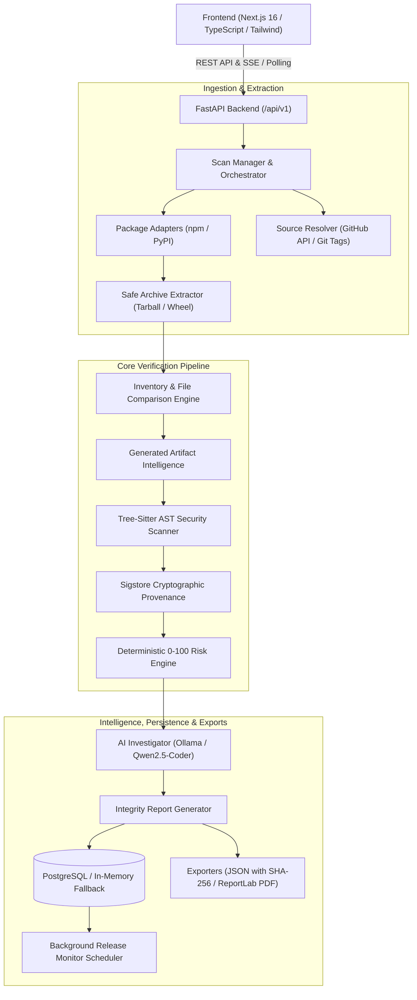

# Veritor System Architecture

Veritor is a supply chain integrity analyzer that detects unauthorized code modifications, hidden install scripts, deceptive artifacts, and security regressions between published package registries (npm, PyPI) and their verified source code repositories (GitHub).

---

## 1. High-Level Architecture

The platform consists of a **FastAPI asynchronous backend** with an event-driven analysis pipeline, a **Tree-Sitter static analysis engine**, a **Sigstore cryptographic verification client**, a **deterministic risk engine**, a **local Ollama AI investigator**, a **PostgreSQL persistence layer**, and a **Next.js responsive dark-themed cybersecurity interface**.

---

## 2. Core Pipeline Components

### 2.1 Package Adapters (`app.adapters`)
- **`NpmAdapter`**: Fetches registry metadata from `https://registry.npmjs.org/<package>`, validates published tarball SHA-512 / SHA-1 digests, and checks registry-declared metadata against the internal `package.json` to detect manifest spoofing.
- **`PyPIAdapter`**: Queries the PyPI JSON API (`https://pypi.org/pypi/<package>/json`), prioritizes binary wheels (`.whl`) or source distributions (`.tar.gz`), verifies SHA-256 hashes against `files.pythonhosted.org`, and parses PEP 508 dependencies.

### 2.2 Safe Archive Extraction (`app.archives.extract`)
- Prevents archive traversal attacks, zip slips, symlink escapes, and compression bombs.
- Strictly bounds maximum archive size, uncompressed byte totals, file count, entry depth, and compression ratio.
- Strips unsafe POSIX permissions, enforcing `0600` file permissions on extracted content.

### 2.3 Multi-Host Source Resolution (`app.source`)
- Implements pluggable `SourceHostAdapter` protocol with `MultiHostSourceResolver` dispatching requests across:
  - **GitHub (`GitHubSourceResolver`)**: Resolves smart-HTTP git upload-pack refs, commits, and codeload archives.
  - **GitLab (`GitLabSourceResolver`)**: Parses GitLab project paths and groups, discovers git refs via packet-line upload-pack stream, and retrieves commit archives via GitLab's archive endpoint (`/-/archive/{commit}/...`).
  - **Bitbucket (`BitbucketSourceResolver`)**: Discovers git refs and downloads commit tarballs (`/get/{commit}.tar.gz`).
- Matches release version to exact git commit using four fallback tiers:
  1. `RECORDED_COMMIT_AND_TAG`: Package declares commit and matching git tag exists.
  2. `PACKAGE_TAG`: Exact package-prefixed tag (e.g. `v1.2.0`, `@scope/pkg@1.2.0`).
  3. `VERSION_TAG`: Bare semver tag (e.g. `1.2.0`).
  4. `RECORDED_COMMIT`: Commit recorded in publish metadata.
- **Strict Invariants**:
  - If no exact commit can be confirmed, the resolver returns `UNCERTAIN`. Veritor never assumes or falls back to the repository's default branch.
  - Unrecognized code hosting platforms return `UNCERTAIN` with `UncertainReason.UNSUPPORTED_HOST` honestly.

### 2.4 Inventory Comparison & Artifact Intelligence (`app.comparison`)
- Computes SHA-256 hashes of all published files against repository files.
- **In-Memory Read Caching (`FileTree`)**: Bounded in-memory read caching eliminates redundant filesystem reads, file descriptor allocations, and SHA-256 hash recalculations for manifests (`package.json`, `tsconfig.json`) and configuration files during scope discovery, evidence extraction, and diff computation.
- Classifies differing files into:
  - `SOURCE_AUTHENTIC`: Exact match with repository source file.
  - `LIKELY_GENERATED`: Verified build artifact supported by build configs (`tsconfig.json`, bundlers), source maps (`.map`), and token similarity.
  - `SUSPICIOUS`: Deceptive source maps, unlinked execution in install scripts, obfuscated code, or executable permission bit elevation.
  - `UNCERTAIN`: Discrepancies without affirmative build evidence.

### 2.5 Static AST Security Scanner (`app.analysis`)
- AST analysis powered by Tree-Sitter for JavaScript and TypeScript (`.js`, `.mjs`, `.cjs`, `.ts`, `.tsx`, `.mts`, `.cts`).
- **Zero Execution**: Code is strictly parsed into syntax trees and never executed.
- **Differential Scanning**: Differentiates between pre-existing source patterns and newly added package modifications to eliminate false positives on legitimate APIs.
- Rules cover 7 primary families:
  1. `EXEC`: Dynamic execution (`eval`, `new Function`, `vm.runInContext`).
  2. `PROC`: Process spawning (`child_process.exec`, `execSync`, `spawn`, `fork`).
  3. `ENV`: Environment inspection (`process.env`, credential dumps, API keys).
  4. `NET`: Network exfiltration (`http`, `https`, `fetch`, raw socket connections).
  5. `OBF`: Obfuscation (Base64 decoding, string hex encoding, Packer identifiers).
  6. `FS`: Sensitive filesystem access (`~/.ssh`, `/etc/passwd`, startup files).
  7. `LIFE`: Lifecycle script modifications (`preinstall`, `install`, `postinstall`).
- Multi-signal correlation rules (`CORR`) flag compound attack patterns (e.g. Base64 decode + dynamic execution, or environment credential access + outbound network transmission).

### 2.6 Cryptographic Provenance Verification (`app.provenance`)
- **npm**: Verifies Sigstore SLSA provenance bundles via Rekor transparency log public key infrastructure. Inspects Fulcio OIDC certificate extensions to confirm build identity, source repository, commit SHA, and GitHub Actions workflow.
- **PyPI (PEP 740)**: Verifies index-hosted PEP 740 digital attestations and wheel/sdist cryptographic digests using the official Sigstore verification suite (`sigstore>=4,<5`, `cryptography>=44`).
  - **Dead Simple Signing Envelope (DSSE)**: Verifies Pre-Authentication Encoding (PAE) cryptographic signatures on ECDSA NIST P-256 with SHA-256 over in-toto statement payloads.
  - **Fulcio OIDC Certificate Identity**: Validates leaf X.509 certificates, checking validity windows, expiration against Rekor transparency log timestamps, and trusted identity providers (`token.actions.githubusercontent.com`, `gitlab.com`, `accounts.google.com`).
  - **Identity & Subject Binding**: Extracts repository, commit SHA, and workflow identity from Fulcio OIDs (`1.3.6.1.4.1.57264.1.*`) and Subject Alternative Name (SAN) URIs; matches signed subject SHA-256 digests against raw distribution bytes on disk.
  - **Strict Security Boundaries**: Unverified bundle metadata is rejected without cryptographic verification (`NOT_VERIFIED`); expired certificates without proof of logging and signature corruption are marked `INVALID`.
- **Result Statuses**: `VERIFIED`, `NOT_VERIFIED`, `UNAVAILABLE`, `INVALID`, `UNCERTAIN`.
- **Safety Invariant**: Missing provenance awards 0 risk points and does not falsely imply maliciousness (`UNAVAILABLE`).

### 2.7 Deterministic Risk Engine (`app.scoring.risk`)
- Transparent 0–100 heuristic scoring based purely on verifiable evidence:
  - Unexpected source differences (+10–40 pts).
  - Suspicious build artifacts (+15–30 pts).
  - High-severity static AST findings (+10–50 pts).
  - Source resolution uncertainty (+10–25 pts).
  - Lifecycle script alterations (+20–40 pts).
- **Hard Security Floors**: Critical findings (e.g., unauthorized install script executing obfuscated payload) trigger immediate score floors ($\ge 70$, `HIGH` or `CRITICAL`).
- Produces `contributing_evidence`, `factors`, `confidence`, `recommendations`, and `limitations`.

### 2.8 AI Behavioral Investigator (`app.ai`)
- Connects locally to Ollama running `qwen2.5-coder:7b`.
- Analyzes deterministic findings and source diffs, providing structured behavioral summaries.
- Validated with strict Pydantic schemas (`FindingExplanation`, `AIInvestigationResult`).
- **Immutable Guardrail**: The AI model is strictly prohibited from altering deterministic risk scores, clearing hard findings, or inventing unsupported claims.
- **Offline Resilience**: When Ollama is offline or unavailable, the pipeline falls back gracefully without interrupting scans.

### 2.9 Relational Persistence & Background Monitoring (`app.db` & `app.monitoring`)
- Backed by PostgreSQL 16 via SQLAlchemy 2.0 ORM and Alembic migrations.
- In-memory fallback enables fully functional standalone operation without database credentials.
- **`ReleaseMonitoringScheduler`**: Runs background checks with rate-limiting delays to detect newly published versions on npm/PyPI, triggers automated scans, and computes release evolution comparisons (`RiskChangeSummary`, `FileChangesSummary`, `FindingChangesSummary`).

### 2.10 Comprehensive Report Exporters (`app.reports`)
- **JSON Exporter**: Generates structured export documents containing complete scan data and a cryptographic SHA-256 integrity hash (`report_integrity_sha256`).
- **PDF Exporter**: Uses ReportLab to generate an executive cybersecurity PDF report featuring a visual risk dial, provenance verification table, file inventory breakdown, AST security findings table, AI explanations, and limitations.
